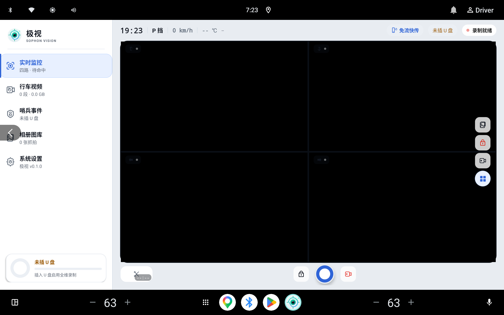

# 极视 (Sophon) - 车规级四向行车记录与智能视觉安全系统

<p align="center">
  
</p>

<p align="center">
  <strong>“极目四方，视守全程。”</strong><br>
  专为 <strong>FlymeAuto</strong> 智能座舱量身打造的新一代<strong>车规级四向全维行车记录、智能盲区感知辅助与车联视觉安全系统</strong>。
</p>

<p align="center">
  
  
  
  
  
</p>

---

## 📸 界面预览

<p align="center">
  
  <br>
  <em>图 1：极视 (Sophon) 车规级四向全维实时监看与 Alive Design 原生座舱界面</em>
</p>

---

## 🌟 项目简介

**极视 (Sophon)** 针对以**领克 08 (Lynk & Co 08)** 为代表搭载**芯擎科技 龙鹰一号 (DragonHawk 1 / SE1000)** 7nm 高性能智能座舱芯片的车型深度定制研发，并广泛兼容基于 Android 9.0+ 的车规级大屏智能座舱生态。

系统打破了传统行车记录仪单路画面视野狭窄、割裂分段存储和高发热卡顿的局限，基于 Camera2 HAL 底层并发调度、OpenGL ES 3.0 硬件合流渲染、车身 VHAL 信号总线只读感知以及 FlymeAuto 原生座舱设计语言融合，为车主提供全天候、多维度、零感融入的行车安全与泊车监控体验。

---

## 🛡️ 三大车载系统安全红线

在车载嵌入式环境中，**系统稳定性与车机行车安全拥有最高优先级**。极视在底层架构中确立了三大不可动摇的黄金法则：

```
       ┌──────────────────────────────────────────────────────────┐
       │                 极视车载三大核心安全红线                  │
       └──────────────────────────┬───────────────────────────────┘
                                  │
         ┌────────────────────────┼────────────────────────┐
         ▼                        ▼                        ▼
┌──────────────────┐    ┌──────────────────┐    ┌──────────────────┐
│  零影响原厂车机  │    │  零写内部闪存    │    │  零篡改车身总线  │
│ Zero Impact IVI  │    │ No Internal Write│    │ Read-Only VHAL   │
├──────────────────┤    ├──────────────────┤    ├──────────────────┤
│• 原厂AVM全景优先 │    │• 严禁写入eMMC/UFS│    │• 仅只读监听广播  │
│• 50ms极速避让释放│    │• 8MB环形内存缓冲 │    │• 严禁下发控制帧  │
│• 守护驾驶安全第一│    │• 直写外置存储U盘 │    │• 零行车电控风险  │
└──────────────────┘    └──────────────────┘    └──────────────────┘
```

1. **零影响原厂车机 (Zero Impact on IVI)**：
   - 驾驶安全高于一切。原厂 360° AVM 环视及倒车影像拥有绝对图层抢占权；
   - 监听原厂倒车/全景调用广播，在 **50ms 内极速让出摄像头节点与图形渲染管线**，确保原厂安全辅助零黑屏、零延迟。
2. **零写内部闪存 (No USB, No Write to UFS/eMMC)**：
   - 保护车机寿命，严禁向车机内部存储空间写入音视频缓存或分片；
   - 采用纯内存 8MB 高速环形缓冲区（Ring Buffer）流转数据，外置 U 盘未就绪时自动阻断落盘，彻底杜绝闪存磨损与车机内部存储耗尽故障。
3. **零篡改车身总线 (Zero Tampering Read-Only VHAL)**：
   - 车身信号监听层采用单向抽象总线（`IVehicleSignalBus`），仅以只读方式被动订阅车速、挡位、转向灯、车门等状态；
   - 坚决杜绝向下发送任何 CAN/VHAL 控制指令，从物理架构层面消除行车电控干扰风险。

---

## ⚡ 核心能力与技术亮点

### 1. 四路全维并发合成录制与 0ms IDR 热切片
- **4 路并发调度**：无缝调度前视、后视、左侧视、右侧视 4 路高清车载摄像头，单路独立生命周期状态机管控；
- **GPU 离屏合流 (OpenGL ES 3.0)**：每路视频流映射至独立 `SurfaceTexture`，通过 FBO 离屏渲染动态合成为单路超宽画卷；
- **单路 MediaCodec 硬件编码**：相比多路独立编码器，单编码器管线大幅降低硬件 VPU 负载与发热，保持帧率丝滑稳定；
- **0ms IDR 热切片**：采用流式分片机制，精准对齐关键帧，分片交接严格 0 毫秒丢帧；
- **断电容灾急救 (`Mp4MoovRescuer`)**：针对车辆熄火骤然断电导致 MP4 索引未闭合的问题，支持在下次启动时秒级重建 moov box，抢救最后一秒关键证据；
- **座舱音频录制 (`CabinAudioEncoder`)**：低比特率 AAC 车规音频硬件编码，支持一键麦克风脱敏静音与硬件时钟音视频同步。

### 2. 全场景智能盲区感知辅助与图像增强 (`OverlayMatrixController`)
- **智能打灯补盲 (`BlindSpotOverlayService`)**：拨动左右转向灯或变道时，毫秒级在车机屏幕对应侧呼出侧后方高清浮窗，方向盘回正后平滑延时淡出；
- **窄道双闪透视**：低速通过狭窄路段开启双闪时，自动呼出左右双侧车身视野，精准观察轮毂距离；
- **DOW (Door Open Warning) 开门防碰撞辅助**：车辆停稳（车速 < 5 km/h）开启车门时，即时弹出对应侧后视窗预警，守护下车乘员及后方非机动车安全；
- **电子后向监看 (`RearViewOverlayService`)**：支持广角后视画面小浮窗常驻或动态调出；
- **车载全能悬浮辅助球 (`AssistBallOverlayService`)**：全局贴边吸附微件，单手点触即刻展开抓拍、紧急加锁、哨兵切换与快捷控制；
- **车规视觉增强着色器 (`ImageTuning`)**：内置 Brown-Conrady 广角光学畸变校正算法，以及专为雨雪、夜间环境调校的透雾增亮着色器，恶劣天气下视野清晰透彻。

### 3. 高能回放与防误删存储生态
- **四路毫秒级同步回放器 (`QuadSyncPlayerActivity`)**：四分屏全局同步检索 $\leftrightarrow$ 双击任意单摄全屏 $2\times$ 矩阵放大无缝切换；
- **时间轴事件标记 (`MarkedSeekBar`)**：在播放进度条上直观打点紧急碰撞 (`Emergency`)、哨兵触发 (`Sentry`) 关键帧，支持“上一事件/下一事件”一键疾速穿梭；
- **资料库分段统计 (`MultiSegmentStorageBarView`)**：行车、哨兵、图库与剩余空间分段可视化；
- **智能历史分类浏览器 (`RecordingHistoryFragment`)**：网格化时间线、多重筛选与缩略图极速缓存；
- **U 盘测速与体检 (`UsbBenchmark`)**：大文件连续写速与小文件随机 IOPS 深度基准评测，精准预警掉速与介质老化；
- **智能回收站缓冲池 (`.Trash/`)**：低存储空间时优先将最旧普通视频移入待删回收站暂存，支持一键还原与彻底粉碎，杜绝关键视频误删。

### 4. 驻车哨兵守护与常用地点安全围栏
- **三轴加速度计碰撞侦测 (`CrashSensorDetector`)**：驻车休眠期异常震动毫秒级唤醒录制并触发声光威慑；
- **常用地点安全围栏 (`SentryHomeGeofence`)**：基于已知安全 Wi-Fi SSID 白名单判据，在家庭私家车位或公司地库停车时自动撤防或降低灵敏度，杜绝误报并守护 12V 蓄电池；
- **12V 小电瓶健康保护 (`PowerStateMachine`)**：实时协同车机电源状态机，低压自动切断哨兵常驻轮询，守护车辆启动电量。

### 5. 无感互联与全天候远程控制
- **局域网免流 H5 共享传送门 (`LanShareServer`)**：手机扫码秒连车机 Wi-Fi / 热点，支持 HTTP 206 断点范围拖动秒播与批量免流打包下载；
- **双向远程机器人控制 (`RemoteDispatcher`)**：原生支持 **Telegram Bot** 与 **企业飞书 (Feishu)** 机器人双向交互，支持远程车况状态查询、即时拍照抓拍、紧急视频片段调用回传；
- **iOS 毫秒级低延迟推送**：支持 **Bark** 通知通道与离线告警消息队列 (`OfflineAlertQueue`)，哨兵异常毫秒级推送至车主手机。

### 6. FlymeAuto 原生座舱体验
- **Alive Design 深度融合**：严格遵循 FlymeAuto 设计规范，纯正深色座舱主题，高辨识度圆角律动视觉；
- **单 Activity 导航轨架构**：主界面采用车规横屏经典 Left Navigation Rail，无缝切换实时监控、行车视频、哨兵事件、相册图库与偏好设置；
- **状态栏灵动胶囊 (`StatusBarCapsuleService`)**：录制状态与录制时长在系统顶栏常驻微卡片展示，支持点击展开快捷操作面板。

---

## 🏛️ 系统分层架构

```mermaid
graph TD
    subgraph 车机硬件与系统层 (Hardware & System HAL)
        CAM[Camera2 API / HAL3 四路摄像头]
        CAN[VHAL / gRPC 车身信号总线]
        USB[Linux V4L2 / USB OTG 高速存储]
        VPU[龙鹰一号 VPU 硬件编解码器]
    end

    subgraph 核心引擎层 (Sophon Core Service)
        HAL_MGR[多路摄像头采集管理器]
        GPU_PIPE[OpenGL ES 3.0 FBO 合流与增强管线]
        CODEC[MediaCodec 硬件编码引擎]
        AUDIO[座舱音频采集与编码器]
        MUXER[0ms IDR 热切片与容灾封装]
        STORAGE[8MB 环形内存缓冲与存储调度器]
        SIGNAL[只读车身信号自适应总线]
        POWER[车载电源状态机管理]
    end

    subgraph 业务守护层 (Guard & Services)
        SENTRY[哨兵与驻车监控守护]
        GEOFENCE[常用地点安全围栏]
        OVERLAY_CTRL[全场景悬浮窗矩阵控制器]
        KEEPALIVE[车机多级保活与前台服务]
        REMOTE_SRV[Telegram / 飞书 / Bark 远程调度]
    end

    subgraph 交互与呈现层 (FlymeAuto Presentation)
        MAIN_UI[MainActivity 主控 + Navigation Rail]
        LIVE_FRAG[实时全景监看面板]
        HIST_FRAG[RecordingHistoryFragment 录像库]
        SENTRY_FRAG[SentryEventReviewFragment 哨兵复盘]
        PHOTO_FRAG[PhotoViewerFragment 相册图库]
        SETTING_FRAG[SophonSettingsFragment 偏好设置]
        CAPSULE[StatusBarCapsuleService 状态栏胶囊]
        WEB_PORTAL[局域网免流 H5 快传服务]
    end

    CAM --> HAL_MGR
    HAL_MGR --> GPU_PIPE
    GPU_PIPE --> CODEC
    AUDIO --> MUXER
    CODEC --> MUXER
    MUXER --> STORAGE
    STORAGE --> USB

    CAN --> SIGNAL
    SIGNAL --> OVERLAY_CTRL
    SIGNAL --> SENTRY
    POWER --> SENTRY
    GEOFENCE --> SENTRY

    KEEPALIVE -.保活守护.-> 核心引擎层
    REMOTE_SRV <==> 核心引擎层
    核心引擎层 <== IPC / Flow ==> 交互与呈现层
```

---

## 📁 项目目录结构

```
Sophon/
├── app/
│   ├── src/main/kotlin/com/vongzh/sophon/
│   │   ├── core/
│   │   │   ├── camera/        # Camera2 多摄调度 (MultiCameraManager)
│   │   │   ├── codec/         # MediaCodec 连续编码、座舱音频与无损剪辑
│   │   │   ├── config/        # 座舱偏好配置 (SophonPreferences) 与图像调校
│   │   │   ├── geofence/      # 常用地点 Wi-Fi SSID 哨兵安全围栏
│   │   │   ├── gl/            # OpenGL ES 3.0 FBO 合流、OSD 水印与雨夜着色器
│   │   │   ├── lan/           # 车载免流局域网快传 HTTP 服务器 (LanShareServer)
│   │   │   ├── power/         # 车载电源状态机与低电量硬切断保护
│   │   │   ├── remote/        # Telegram、飞书机器人、Bark 推送与离线消息队列
│   │   │   ├── sensor/        # 三轴加速度计碰撞与急刹感知 (CrashSensorDetector)
│   │   │   ├── storage/       # 8MB 内存环形缓冲、MP4 索引急救器与 U 盘体检
│   │   │   └── vhal/          # 多源自适应车身信号只读监听总线
│   │   ├── domain/            # 领域契约接口与数据模型
│   │   ├── service/           # 核心服务 (SophonCoreService) 与全场景悬浮窗矩阵
│   │   ├── ui/                # FlymeAuto 原生座舱交互层
│   │   │   ├── MainActivity.kt            # 主控容器 (承载 Navigation Rail 与 Fragment 调度)
│   │   │   ├── OnboardingActivity.kt      # 首启合规门 (隐私政策声明与权限透明化)
│   │   │   ├── history/                   # 历史录像资料库组件 (RecordingHistoryFragment)
│   │   │   ├── photo/                     # 相册图库组件 (PhotoViewerFragment)
│   │   │   ├── playback/                  # 四路同步回放器 (QuadSyncPlayerActivity)
│   │   │   ├── sentry/                    # 哨兵事件复盘 (SentryEventReviewFragment) 与全屏威慑
│   │   │   ├── settings/                  # 10 大分类卡片式座舱设置 (SophonSettingsFragment)
│   │   │   ├── statusbar/                 # 顶部状态栏灵动胶囊服务 (StatusBarCapsuleService)
│   │   │   └── widget/                    # MarkedSeekBar、分段容量条与雷达态势视图
│   │   └── SophonApp.kt       # 全局应用上下文与单例依赖注入
│   ├── src/main/res/          # FlymeAuto 规范布局、深浅自适应主题与车规矢量资源
│   └── build.gradle.kts       # 模块构建脚本
├── docs/                      # 核心架构与车规技术规范文档
│   ├── ARCHITECTURE_DESIGN.md             # 核心系统架构设计
│   ├── SYSTEM_SAFETY_PRINCIPLES.md        # 车载系统安全与稳定性最高准则
│   ├── BENCHMARK_AND_CAPABILITY_MATRIX.md # 技术能力与行业方案对照矩阵
│   ├── design/                            # 车规 HMI 设计系统规范与双主题设计稿
│   └── screenshots/                       # 车机界面高清预览截图
├── gradle/                    # Gradle 包装器
├── build.gradle.kts           # 顶级工程构建脚本
├── settings.gradle.kts        # 工程模块索引
├── CONTRIBUTING.md            # 开发者开源贡献指南
├── LICENSE                    # GNU GPL v3.0 许可证
└── README.md                  # 项目总览说明文档
```

---

## 🛠️ 编译与构建说明

### 编译环境要求
- **操作系统**：Windows 10/11 / macOS / Linux
- **JDK 版本**：OpenJDK 17 或更高版本 (推荐使用 Android Studio 内置 JBR 17)
- **Android SDK**：API Level 35 (compileSdk: 35, minSdk: 28)
- **Gradle 架构**：Kotlin DSL (`build.gradle.kts`)

### 构建命令

```bash
# 1. 确保设置 JAVA_HOME (以 Windows Android Studio JBR 为例)
$env:JAVA_HOME = "C:\Program Files\Android\Android Studio\jbr"

# 2. 编译代码并执行静态代码检查
./gradlew check

# 3. 编译 Debug 开发测试包
./gradlew assembleDebug

# 4. 编译 Release 车载签名发布包
./gradlew assembleRelease
```

构建生成的 APK 文件路径：
- Debug: `app/build/outputs/apk/debug/app-debug.apk`
- Release: `app/build/outputs/apk/release/app-release.apk`

---

## 🤝 参与贡献

欢迎对车载智能座舱技术感兴趣的开发者参与贡献！在提交 Issue 或 Pull Request 前，请务必阅读 [`CONTRIBUTING.md`](CONTRIBUTING.md)，并严格遵守项目确立的 [《三大车载系统安全红线》](docs/SYSTEM_SAFETY_PRINCIPLES.md)。

---

## 📜 开源协议

本项目遵循 **GNU General Public License v3.0 (GPL-3.0)** 开源许可协议，完整文本请参阅项目根目录下的 [`LICENSE`](LICENSE)。

```
Copyright (C) 2026 vongzh

This program is free software: you can redistribute it and/or modify
it under the terms of the GNU General Public License as published by
the Free Software Foundation, either version 3 of the License, or
(at your option) any later version.

This program is distributed in the hope that it will be useful,
but WITHOUT ANY WARRANTY; without even the implied warranty of
MERCHANTABILITY or FITNESS FOR A PARTICULAR PURPOSE.  See the
GNU General Public License for more details.
```

---

## ⚖️ 免责声明

1. 本项目为**独立开源技术研究与开发项目**，与相关汽车厂商及其关联公司**无任何商业附属或官方授权关系**。文中提及之车型名称、操作系统及硬件芯片名称仅用于兼容性客观技术描述，其知识产权均归其对应权利人所有。
2. 本项目仅提供**行车视听记录与驾驶盲区辅助感知功能**，**绝不直接介入或替代任何车辆动态驾驶控制**。驾驶员在行车过程中必须对行车安全负有完全法律与操作责任。
3. 行车过程中严禁手动操作车机界面。请确保在符合当地道路交通安全及个人隐私保护法律法规的前提下使用本软件。
