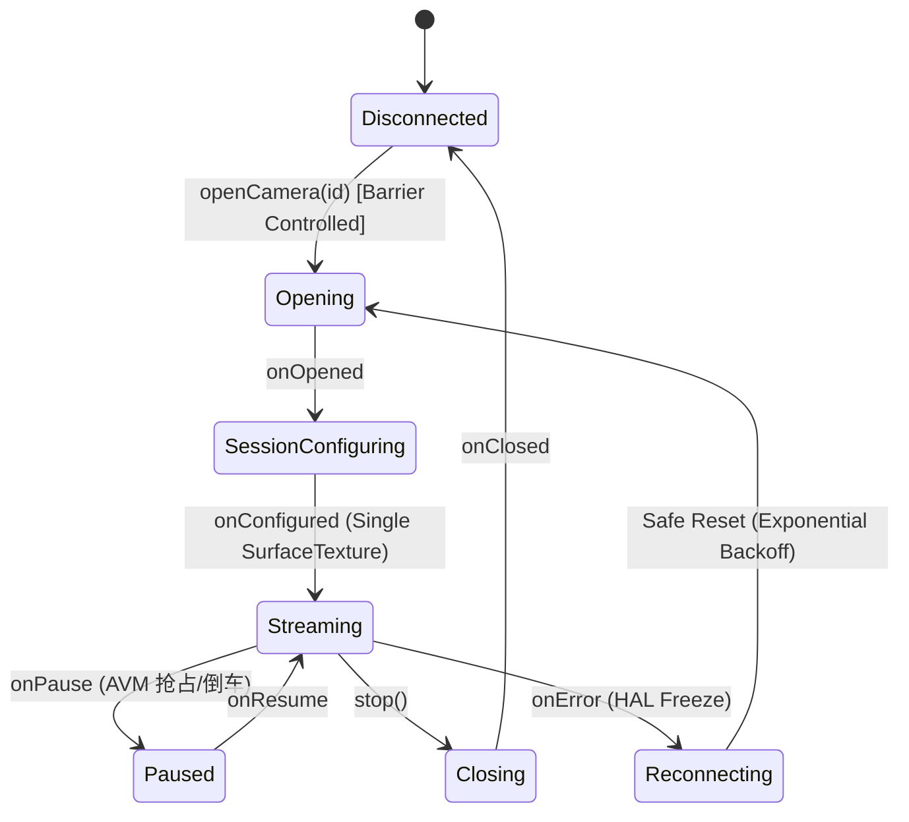
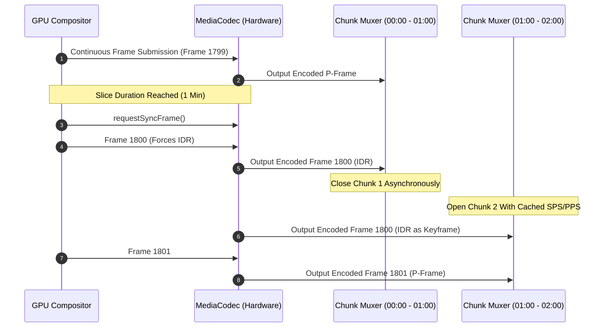
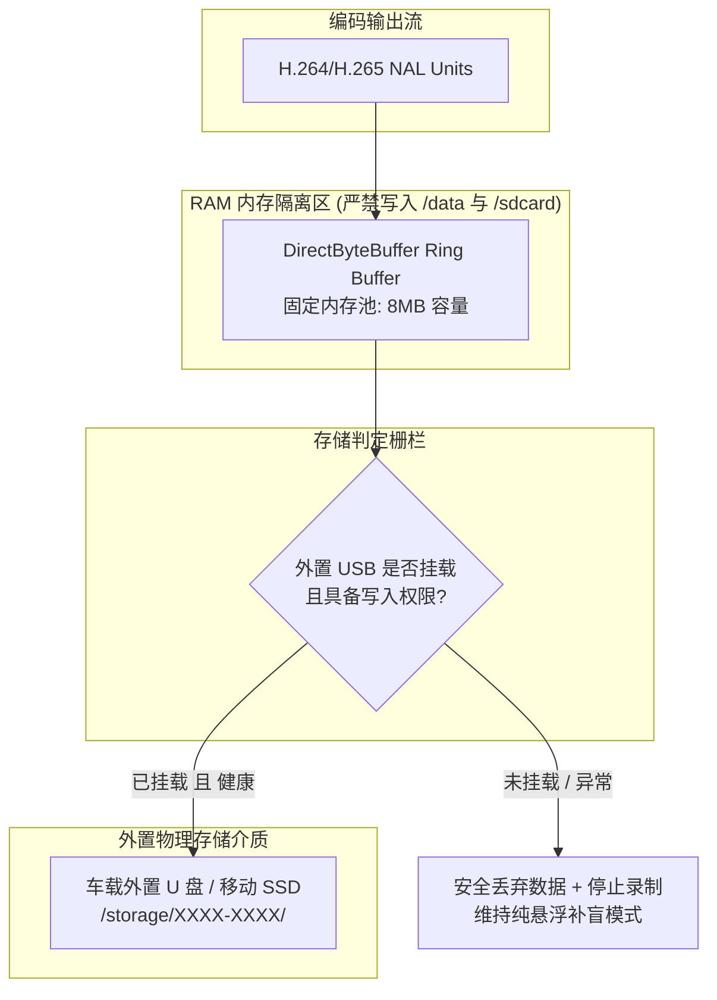
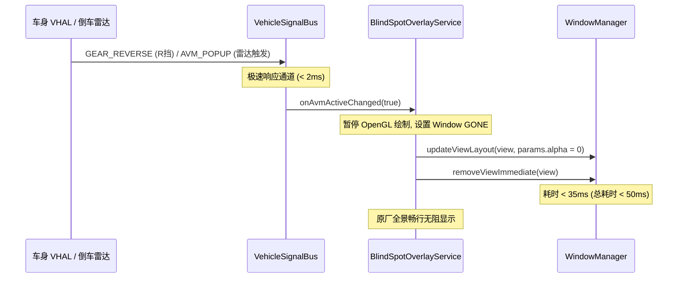

# 极视 (Sophon) 智能座舱行车记录与全维哨兵系统架构设计规范

> **平台架构**：吉利 / 魅族 FlymeAuto 智能座舱系统 (Android 9 / 11 深度定制车载 OS)  
> **底层芯片**：芯擎科技 龙鹰一号 (DragonHawk 1 / SE1000) 7nm 高性能车载座舱芯片  
> **基准车型**：领克 08 (Lynk & Co 08) 及同平台架构车型 (领克 07、银河 E5 等)  
> **设计版本**：v1.0.0 Architecture Specification  
> **合规基线**：严格遵循 [`docs/SYSTEM_SAFETY_PRINCIPLES.md`](file:///D:/Code/Sophon/docs/SYSTEM_SAFETY_PRINCIPLES.md) 三条绝对安全底线

---

## 目录
1. [系统总体设计目标与边界](#一系统总体设计目标与边界)
2. [分层架构设计 (Clean Architecture)](#二分层架构设计-clean-architecture)
3. [车载视觉采集管线 (Camera2 HAL3 Concurrency Barrier)](#三车载视觉采集管线-camera2-hal3-concurrency-barrier)
4. [GPU 渲染合成与光学矫正管线 (OpenGL ES Compositor & Shaders)](#四gpu-渲染合成与光学矫正管线-opengl-es-compositor--shaders)
5. [零掉帧连续硬件编码与容灾封装 (MediaCodec & Fault-Tolerant Muxer)](#五零掉帧连续硬件编码与容灾封装-mediacodec--fault-tolerant-muxer)
6. [严格“No USB, No Write”纯内存环形缓冲存储系统](#六严格no-usb-no-write纯内存环形缓冲存储系统)
7. [车身信号总线与毫秒级 AVM 避让系统 (IVehicleSignalBus)](#七车身信号总线与毫秒级-avm-避让系统-ivehiclesignalbus)
8. [FlymeAuto 原生座舱交互设计 (UI & Navigation Rail)](#八flymeauto-原生座舱交互设计-ui--navigation-rail)
9. [多进程模型与沙箱级容灾防崩](#九多进程模型与沙箱级容灾防崩)
10. [性能与功耗预算指标 (SLA & Performance Budget)](#十性能与功耗预算指标-sla--performance-budget)

---

## 一、系统总体设计目标与边界

### 1.1 项目定位
极视 (Sophon) 是专为吉利/魅族 **FlymeAuto** 智能座舱与 **芯擎科技 龙鹰一号 (SE1000)** 定制开发的工业级车载四向行车记录、盲区辅助视觉与智能哨兵系统。

### 1.2 三大安全底线实施细则
根据项目最高准则，架构实施中必须落地以下技术封套：
1. **绝不影响车机 (Zero Impact on IVI)**：
   - 100% 龙鹰一号 VPU 硬件编码，CPU 占用率峰值严格 $\le 6\%$；
   - 补盲悬浮窗未激活时，OpenGL 渲染管线彻底休眠，GPU 负载归零；
   - 检测到原厂 AVM / 倒车 360 全景信号时，在 **50ms 内无条件隐身悬浮窗**。
2. **绝不写入车机自带磁盘 (Zero Write to Internal Flash / UFS)**：
   - 贯彻 **"No USB, No Write"**。内部存储（`/data`、`/sdcard`、`Internal UFS`）写吞吐量为 **严格 0 字节/秒**；
   - 采用 Direct RAM 环形缓存（4MB~8MB），流式直写外置 USB 3.0/2.0 设备；拔出 U 盘时丢弃缓冲并不落盘。
3. **绝不修改系统原有设置与数据 (Zero Tampering)**：
   - 对 VHAL/CAN 信号仅作为 `Read-Only Subscriber` 监听，底层接口不声明任何写方法；
   - 零修改系统 Settings，纯私有沙箱存储配置，卸载即完全还原原厂状态。

---

## 二、分层架构设计 (Clean Architecture)

系统采用单向数据流与清晰的四层分层解耦架构，彻底告别单体 Activity 巨石代码：

```mermaid
graph TD
    subgraph UI_LAYER["第四层：FlymeAuto 交互与展示层 (Presentation)"]
        UI_MAIN[FlymeAuto 主控界面 (Navigation Rail)]
        UI_LIVE[四路同屏实时监看 (1x4 / 2x2)]
        UI_PLAYER[事件时间轴同步回放器 (MarkedSeekBar)]
        UI_STORAGE[四色存储容量环形图 (StorageCapacityRingView)]
        UI_FLOAT[盲区补盲悬浮窗 (50ms 避让)]
    end

    subgraph SERVICE_LAYER["第三层：业务服务与状态协调层 (Service & Guardian)"]
        CORE_SVC[SophonCoreService (主前台守护服务)]
        BLIND_SVC[BlindSpotGuardian (转向灯/开门盲区调度器)]
        SENTRY_SVC[SentryGuardian (低功耗移动侦测与哨兵守护)]
        STATE_HOLDER[VehicleStateCoordinator (座舱上下文状态机)]
    end

    subgraph ENGINE_LAYER["第二层：核心视觉与存储引擎层 (Core Engines)"]
        CAM_MGR[MultiCameraBarrierManager (Camera2 HAL3 栅栏调度)]
        GL_COMPOSITOR[UnifiedGpuCompositor (EGL/OES/鱼眼/OSD)]
        CODEC_PIPELINE[ContinuousMediaCodecPipeline (无感切片硬件编码)]
        VAULT_MGR[StorageVaultManager (RAM RingBuffer + USB 直写)]
        VHAL_BUS[VehicleSignalBus (只读信号反应式总线)]
    end

    subgraph HAL_LAYER["第一层：车机底层与硬件抽象层 (Hardware & System HAL)"]
        HAL_CAM[龙鹰一号 Camera HAL3 / Multi-Camera ISP]
        HAL_VPU[龙鹰一号 VPU H.264/H.265 硬件编解码器]
        HAL_GPU[Mali-G78 GPU / EGL 1.4 / GLES 3.0]
        HAL_VHAL[车机 ECARX / gRPC / CarPropertyManager VHAL]
        HAL_USB[Linux V4L2 / USB OTG Block Device]
    end

    UI_LAYER -->|Flow / Binder IPC| SERVICE_LAYER
    SERVICE_LAYER -->|Command & Observe| ENGINE_LAYER
    ENGINE_LAYER -->|HAL3 / NDK / ioctl| HAL_LAYER
```

### 2.1 模块分包规划 (`com.vongz.sophon`)
```
com.vongz.sophon/
├── core/
│   ├── camera/          # Camera2 HAL 抽象、多摄像头并发栅栏、Surface 生命周期管理
│   ├── gl/              # EGL 上下文、OES 纹理管理、鱼眼矫正着色器、OSD 时间戳合成器
│   ├── codec/           # MediaCodec 硬件编码流水线、零掉帧 IDR 快速切片、fMP4/TS 复用器
│   ├── storage/         # StorageVault、纯内存环形缓冲区 (RamRingBuffer)、USB 挂载监控
│   └── vhal/            # IVehicleSignalBus、车机信号只读观察者 (转向、车门、车速、AVM)
├── service/
│   ├── SophonCoreService.kt         # 核心前台录制与生命周期管理服务
│   ├── BlindSpotOverlayService.kt   # 盲区补盲微件服务 (支持 50ms 原厂 AVM 隐身)
│   └── SentryGuardianService.kt     # 哨兵事件触发与低功耗监听服务
├── ui/
│   ├── common/          # FlymeAuto 风格控件 (LeftNavRail, MarkedSeekBar, StorageRingView)
│   ├── live/            # 实时四路监控画面组件 (支持单屏、四分屏切换)
│   ├── playback/        # 四路同步回放播放器
│   └── settings/        # 车载设置界面
└── domain/
    ├── model/           # 信号实体、录制事件、存储状态
    └── contract/        # 全局抽象契约接口
```

---

## 三、车载视觉采集管线 (Camera2 HAL3 Concurrency Barrier)

### 3.1 龙鹰一号 ISP 与 HAL3 并发约束
在龙鹰一号 (SE1000) 芯片上，车载摄像头模组（前视、后视、左侧视、右侧视）挂载于底层多路 CSI-2 接口，受以下物理规律约束：
- **Surface 数量敏感**：CameraDevice 若创建多个动态 Surface（如一个送录制，一个送预览，一个送分析），频繁启停 CaptureSession 极易造成底层 CSI 驱动死锁或帧率骤降至个位数；
- **单路单 Surface 铁律**：每路 Camera 仅绑定唯一的 `SurfaceTexture` 作为输出目标，后续所有分发与变换完全交由 GPU 离屏管线处理；
- **并发打开顺序栅栏**：4 路摄像头不能同时并发调用 `openCamera`，否则会触发 HAL 瞬时带宽拥塞。必须采用**串行化打开栅栏 (Camera Open Barrier)**，间隔 150ms 逐一握手。

### 3.2 采集管线状态机


### 3.3 BufferQueue 永不挂起准则
- 当处于“仅补盲无录制”或“仅录制无预览”状态时，OpenGL 线程仍须以最小代价执行 `updateTexImage()` 与 `releaseTexImage()`，释放 SurfaceTexture 内置 BufferQueue。
- 若停止排空 BufferQueue，底层 HAL 缓冲队列在 4~5 帧后将被填满，导致相机驱动抛出 `CAMERA_ERROR_DEVICE (3)` 崩溃。

---

## 四、GPU 渲染合成与光学矫正管线 (OpenGL ES Compositor & Shaders)

### 四路合并单流编码架构
传统方案分别启动 4 个 MediaCodec 实例，在 SE1000 上会导致编码器频段拉满、发热升温。Sophon 采用 **GPU 离屏合流 (Offscreen Quad Compositor)**：
- 将四路摄像头画面通过 OpenGL ES 3.0 合成至单张 $3840 \times 1080$ 或 $1920 \times 1080$ 的画布；
- 仅启动 **单实例 MediaCodec** 处理高分辨率合成流，大幅降低 GPU 交换开销与 VPU 功耗。

```mermaid
graph LR
    CAM_F[前视 OES] -->|Texture 0| FBO[OpenGL Offscreen FBO]
    CAM_B[后视 OES] -->|Texture 1| FBO
    CAM_L[左视 OES] -->|Brown-Conrady 矫正| FBO
    CAM_R[右视 OES] -->|Brown-Conrady 矫正| FBO
    OSD[高精度 OSD 引擎<br/>时间戳+车速+档位] --> FBO
    
    FBO -->|Shared Texture| EGL_ENC[EGLSurface (MediaCodec Input)]
    FBO -.按需绘制.-> EGL_UI[EGLSurface (Screen / Overlay)]
```

### 4.2 左右后视镜鱼眼去畸变着色器 (Brown-Conrady Shader)
车载侧视摄像头通常为 $150^\circ \sim 180^\circ$ 广角镜头，直接录制会导致侧向车道严重弯曲。采用片段着色器实时反向多项式投影：
$$\theta_d = \theta \cdot (1 + k_1 \theta^2 + k_2 \theta^4)$$
在 GLSL 着色器中高效并行计算：
```glsl
#version 300 es
#extension GL_OES_EGL_image_external_essl3 : require
precision highp float;

in vec2 vTexCoord;
out vec4 fragColor;

uniform samplerExternalOES uTexture;
uniform vec2 uFocalLength;
uniform vec2 uPrincipalPoint;
uniform vec4 uDistortion; // k1, k2, p1, p2

void main() {
    vec2 xy = (vTexCoord - uPrincipalPoint) / uFocalLength;
    float r2 = dot(xy, xy);
    float radial = 1.0 + uDistortion.x * r2 + uDistortion.y * r2 * r2;
    vec2 correctedXY = xy * radial;
    vec2 correctedUV = correctedXY * uFocalLength + uPrincipalPoint;
    
    if (correctedUV.x < 0.0 || correctedUV.x > 1.0 || correctedUV.y < 0.0 || correctedUV.y > 1.0) {
        fragColor = vec4(0.0, 0.0, 0.0, 1.0);
    } else {
        fragColor = texture(uTexture, correctedUV);
    }
}
```

### 4.3 GPU 动态休眠节能器
- **条件休眠机制**：如果前台没有 UI 界面，且转向灯未亮（盲区悬浮窗不可见），预览输出的 EGLSurface 渲染循环被完全阻塞（`wait()`）；
- 离屏合成管线降频至 25fps（录制所需帧率），绝不在非必要时刻以 60fps 刷新，确保 GPU 核心温度平稳。

---

## 五、零掉帧连续硬件编码与容灾封装 (MediaCodec & Fault-Tolerant Muxer)

### 5.1 根治 EVCam 500ms 切片丢帧的架构设计
EVCam 在每段视频切片（如 1 分钟）到期时，会调用 `mediaRecorder.stop()` 并重新初始化，导致 Camera CaptureSession 重启或 MediaCodec 管道清空，产生 300~600ms 的视频盲区。

**Sophon 解决方案：编码器永不重启 (Continuous Stream Slicing)**：
1. **持续编码**：MediaCodec 从系统启动录制后，持续向 Input Surface 喂帧，底层编码管线永不停止；
2. **IDR 关键帧强制对齐**：通过 `Bundle` 定时向 MediaCodec 请求关键帧：
   ```kotlin
   val params = Bundle().apply {
       putInt(MediaCodec.PARAMETER_KEY_REQUEST_SYNC_FRAME, 0)
   }
   codec.setParameters(params)
   ```
3. **Muxer 流式热切换**：
   - 提取到带有 `BUFFER_FLAG_KEY_FRAME` 且时间戳跨越切片周期的关键帧；
   - 当前分片 Muxer 写入收尾数据并异步关闭（在后台 I/O 线程）；
   - 新分片 Muxer 复用相同的 `MediaFormat`（SPS/PPS 头部），立即写入该 IDR 帧作为第一帧；
   - **丢帧数：严格 0 帧；交接耗时：严格 0 毫秒**。



### 5.2 容灾流式容器架构 (fMP4 / MPEG-TS)
传统 MP4 容器如果车辆突然断电（熄火、碰撞），导致文件尾部的 `moov` box 未写入，整段视频将无法播放。
- **默认容器**：采用 **Fragmented MP4 (fMP4)** 或 **MPEG-TS** 流式写入；
- **分段原子性**：每个 MOOF/MDAT 片段（2 秒）具备独立的索引；即使车机在行驶中被强制断电，断电前已刷入 U 盘的视频均完整可用，损坏窗口小于 1.5 秒。

---

## 六、严格“No USB, No Write”纯内存环形缓冲存储系统

### 6.1 零写入车机闪存保障机制


### 6.2 存储目录结构规范
外置 U 盘根目录下统一创建标准层级：
```
USB:/SophonRecord/
├── Normal/          # 常规行车记录 (循环覆盖)
│   ├── 20261013_172000_F.mp4
│   └── 20261013_172100_F.mp4
├── Event/           # 碰撞/紧急录制 (写保护，不参与常规轮转覆盖)
│   └── 20261013_172530_COLLISION_F.mp4
├── Sentry/          # 哨兵事件记录 (移动侦测/震动唤醒)
│   └── 20261013_180012_SENTRY_F.mp4
├── Snapshot/        # 手动抓拍与事故拍照
│   └── 20261013_173000_SHOT.jpg
└── .metadata/       # 快速索引数据库与缩略图缓存 (仅在外置 U 盘生成)
```

### 6.3 存储健康与自动清理算法 (Auto-Prune FIFO)
- **容量水位警报**：
  - 剩余可用空间 $< 10GB$：触发后台静默清理，按时间戳升序淘汰 `Normal/` 目录下最早的切片；
  - 剩余可用空间 $< 2GB$：暂停常规录制，发送车机弹窗提醒用户 U 盘空间不足；
- **只读保护自检**：
  - 挂载时立即执行 $4KB$ 临时文件读写测试，如遇只读文件系统（如 NTFS 未被车载内核支持或存储卡坏块锁死），立刻报错提示，**严禁回退至内部闪存**。

---

## 七、车身信号总线与毫秒级 AVM 避让系统 (IVehicleSignalBus)

### 7.1 单向只读信号监听总线架构
根据底线三，所有的车身数据接入必须经过抽象只读接口 `IVehicleSignalBus`：

```kotlin
interface IVehicleSignalBus {
    val turnSignalState: StateFlow<TurnSignalState>
    val carSpeed: StateFlow<Float>
    val gearState: StateFlow<GearState>
    val avmActiveState: StateFlow<Boolean>
    val doorAjarState: StateFlow<DoorState>
    val sentryTriggerEvent: SharedFlow<SentryEvent>
}
```

- **数据源适配器**：
  - **龙鹰一号 CarPropertyManager 适配器**：通过 Android Car API 只读读取 `GEAR_SELECTION`、`PERF_VEHICLE_SPEED` 等；
  - **ECARX VHAL gRPC 适配器**：连接车机本地 UNIX Domain Socket / gRPC 端点监听车门、转向灯信号；
  - **Logcat 兜底信号提取器**：作为非 root 状态下的只读旁路，通过匹配系统日志捕获开关灯广播。

### 7.2 50ms 原厂全景 (AVM) 避让保证机制
行车安全第一，第三方悬浮窗绝不允许阻挡领克 08 原厂 360 倒车影像。


---

## 八、FlymeAuto 原生座舱交互设计 (UI & Navigation Rail)

结合对 FlymeAuto 设计规范与竞品（盯盯车）优秀体验的解构，极视 (Sophon) 的 UI 设计原则为**极简、大触控区、深色护眼、无感悬浮**。

### 8.1 经典左侧导航栏布局 (Left Navigation Rail)
采用横屏座舱最易单手触达的左侧 80dp 紧凑常驻导航栏：
- **实时监控 (Live)**：四路大四分屏 / 一大三小画中画，实时展示各视角画面；
- **行车视频 (Driving)**：支持日期筛选与事件标记（碰撞/急刹）的时间轴浏览；
- **哨兵视频 (Sentry)**：驻车事件列表，缩略图直观展示触发源；
- **行程记录 (Trip)**：行车轨迹与能耗分析图表（结合车速与 GPS 数据）；
- **相册图库 (Photos)**：手动一键抓拍的精彩瞬间与碰撞锁存照片；
- **软件设置 (Settings)**：补盲悬浮窗开关、防眩光校正、U 盘格式化。

### 8.2 核心座舱微件规范
1. **MarkedSeekBar（刻度事件进度条）**：
   - 绿色区间：常规连续行车录制；
   - 红色标线：紧急制动 / G-Sensor 碰撞锁存时间点；
   - 黄色标线：哨兵模式移动侦测事件点；
2. **StorageCapacityRingView（四色存储环形图）**：
   - 蓝色：行车记录占比；
   - 橙色：哨兵记录占比；
   - 绿色：抓拍照片占比；
   - 灰色：U 盘剩余可用容量；
3. **盲区补盲悬浮窗 (BlindSpotOverlay)**：
   - 转向灯触发时，屏幕左下角/右下角滑入 $480 \times 320$ 动态浮窗；
   - 带有防眩光绿波滤波与超视距广角矫正。

---

## 九、多进程模型与沙箱级容灾防崩

为了防止复杂 UI、图库加载导致核心录制进程卡顿，系统拆分为双进程模型：

```
PID 1: com.vongz.sophon:core (核心系统守护进程)
  ├── SophonCoreService
  ├── Camera2 Pipeline
  ├── OpenGL Offscreen Compositor
  ├── MediaCodec Hardware Encoder
  ├── StorageVault
  └── IVehicleSignalBus
  
PID 2: com.vongz.sophon (界面交互客户端进程)
  ├── MainActivity
  ├── PlaybackActivity
  ├── VideoPlayer Engine
  └── Settings UI
```

### 9.1 进程解耦优势
1. **UI 崩溃不影响录制**：即使用户在播放 4K 视频时触发 OOM 导致 UI 进程重启，后台 `:core` 进程的行车记录与打灯补盲绝不断帧；
2. **内存极限定界**：`:core` 进程不包含任何大图缓存库（Glide），只保留原生 Direct 内存，运行期内存严格稳定在 $\le 65\text{MB}$。

---

## 十、性能与功耗预算指标 (SLA & Performance Budget)

| 评价维度 | 目标指标 | 极限阈值 | 监控与兜底措施 |
| :--- | :--- | :--- | :--- |
| **CPU 占用率** (龙鹰一号) | $\le 3.5\%$ | $6.0\%$ | 严禁软编，全硬件编解码与原生线程池调度 |
| **GPU 占用率** | 录制时 $\le 4\%$ / 待机 $0\%$ | $8.0\%$ | 悬浮窗隐藏时完全挂起 OpenGL ES 渲染管线 |
| **车机闪存写入量** | **严格 0 Byte/s** | **严格 0 Byte/s** | 贯彻 "No USB, No Write"，拔卡立即关停落盘 |
| **原厂 AVM 避让响应** | $\le 30\text{ms}$ | $50\text{ms}$ | 悬浮窗采用透明化与立即解绑双重撤销策略 |
| **切片文件交接盲区** | **严格 0 帧 (0ms)** | $0\text{ms}$ | 持续 MediaCodec 实例 + IDR 热切片封装 |
| **断电视频容灾损坏率** | $\le 1.5\text{s}$ 未落盘数据 | $3.0\text{s}$ | 流式 fMP4 / TS 容器，每 2 秒一次物理 flush |
| **核心守护进程物理内存** | $\le 65\text{MB}$ | $100\text{MB}$ | 单 SurfaceTexture + 8MB 内存环形池防泄漏 |

---

> **架构师签批声明**：本架构设计规范作为项目代码编写、单元测试与发布交付的唯一最高技术标准。任何违背三条绝对安全底线的设计，在 Code Review 阶段均实行一票否决。
