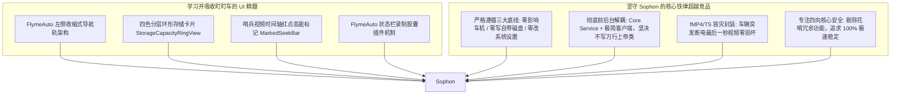

# 盯盯车 (SurCamX V1.4.6) 界面设计与底层架构深度反编译分析报告

> **编制说明**：本报告基于对放置于 `D:\Code\Sophon\docs\` 下的竞品安装包 `盯盯车_通用版_V1.4.6.apk` 进行完整反编译（逆向提取 `AndroidManifest.xml`、全套资源布局 `res/layout`、Smali/DEX 字节码还原为 2,542 个 Java 源码类，以及 `arm64-v8a` 原生 Native 动态链接库），深度剖析其优秀的 UI/UX 界面设计规范与底层核心架构，为 **Sophon (智子)** 的界面与功能研发提供权威参考。

---

## 一、 竞品全景图谱与反编译基本信息

- **应用包名**：`com.sunslin.surcamx` (SurCamX)
- **应用名称**：`盯盯车Ⓣ` (Version: `1.4.6`, VersionCode: `1`, TargetSdk: `36`, MinSdk: `28`)
- **适用平台**：深度适配吉利 / 魅族 FlymeAuto（涵盖领克 07、领克 08、银河系列及龙鹰一号 SE1000 平台）
- **核心 Native 资产**：
  - `libsurcam_recorder.so` (424 KB)：C++ 实现的统一画面合成器（Compositor）与车况 OSD 注入录制引擎；
  - `libvhal_decoder.so` (16 KB)：与 EVCam 相同谱系的车身 VHAL 信号二进制协议解码库。

---

## 二、 盯盯车出色 UI/UX 设计拆解（为什么看着舒服？）

盯盯车的界面之所以被大量领克和银河车主评价为“原厂感极强、设计出色”，核心在于它**深度吃透并严格遵循了魅族 FlymeAuto 的车载大屏设计规范**：

```
┌─────────────────────────────────────────────────────────────────────────────┐
│                             FlymeAuto 屏幕主界面 (横屏)                      │
├─────────────┬───────────────────────────────────────────────────────────────┤
│ 左侧导航轨   │                      右侧核心内容展示区                         │
│ (Nav Rail)  │                                                               │
│             │  [四路低延迟画面 / 2x2 宫格 / 单摄全屏]                         │
│ 🔘 实时监控  │                                                               │
│ 🎬 行车视频  ├───────────────────────────────────────────────────────────────┤
│ 🛡️ 哨兵视频  │  [存储容量环形图]         [今日行程卡片]      [快捷车控开关]      │
│ 🗺️ 行程记录  │  - 视频 45.2GB (70%)     - 里程: 28.5km     - 结束充电          │
│ 🖼️ 相册图库  │  - 哨兵 12.0GB (18%)     - 能耗: 15.2kWh    - 雨夜增强 [开]     │
│ 🗑️ 待删队列  │  - 照片 1.2GB  (2%)      - 均速: 42km/h     - 外部喊话 [开]     │
│ ⚙️ 软件设置  │  - 空闲 6.4GB  (10%)                                         │
└─────────────┴───────────────────────────────────────────────────────────────┘
```

### 1. 左侧折叠式导航轨 (Left Nav Rail / `nav_rail_collapsed.xml`)
- **布局哲学**：拒绝手机端传统的底部 Tab，拥抱车机端最经典的**左侧纵向导航轨 (Navigation Rail)**，驾驶员触手可及。
- **菜单流设计**：
  1. **实时监控** (`nav_live_view`)：主摄及四向并发低延迟预览；
  2. **行车视频** (`nav_driving_videos`)：常规行车循环切片流；
  3. **哨兵视频** (`nav_sentinel_videos`)：驻车碰撞与异动事件专属库；
  4. **行程记录** (`nav_trip_records`)：基于车身里程与能耗的行程统计看板；
  5. **相册图库** (`nav_photos`)：照片与手动抓拍；
  6. **待删资源** (`nav_deletion_queue`)：智能回收站与保护锁机制；
  7. **软件设置** (`settings_title`)：车型与硬件参数；
  8. **快捷车控** (`settings_stop_charging_action`)：集成原厂车控动作（如结束充电）。

### 2. 拟物化与原生车规组件
盯盯车没有使用 Android 原生的粗糙控件，而是自定义了一整套 Flyme 质感控件：
- **`FlymeSwitch` & `PillSwitch`**：定制胶囊状药丸开关，去除默认 CheckBox 边框，采用高斯模糊背景与平滑滑动阻尼。
- **`RecordShutterButtonLayout`**：带有呼吸光环的居中录制快门大圆纽，模拟专业相机快门质感。
- **`StorageCapacityRingView` (环形多色存储仪表盘)**：
  - **核心逻辑**：采用 4 种颜色圆弧叠加绘制在同一仪表环上（`drawArc`）：
    - `storage_bar_video`（行车视频，蓝色）
    - `storage_bar_sentry`（哨兵视频，橙红色，警示性强）
    - `storage_bar_photo`（静态照片，绿色）
    - `storage_bar_other`（其他数据，灰色）
    - `storage_bar_free`（剩余可用，底色环）
  - 车主一眼就能清晰看出“哨兵”占了多少比例、“行车”占了多少比例，彻底告别单调数字。

---

## 三、 独家特色高阶功能逆向深度剖析

### 1. 哨兵专属播放器与高能标记时间轴 (`SentryVideoPlayerActivity`)
- **核心组件**：自定义控件 `MarkedSeekBar`（带事件打点的进度条）。
- **特斯拉同款设计**：
  - 传统播放器的进度条是一条纯色灰线。
  - 盯盯车的 `MarkedSeekBar` 可以在时间轴上绘制**红/黄高能标记圆点（Pip Markers）**，指示发生震动、有人拉门或微波雷达感应的精确时间点。
  - 用户点击前后跳转按钮（`ImageButton U, V, W, X`），播放器自动快速 Seek 到下一次触发事件发生前 3 秒，**无需用户反复拖拽进度条盲猜哪个时间点发生了刮蹭**！

### 2. 行程总结大屏与高德变色轨迹系统 (`trip/` & `dashboard/`)
盯盯车不仅是个录像机，还演进成了**车载行程数据中枢**：
- **6 套车规级独立图表控件**：
  - `DashboardDonutView`：能耗/时间构成甜甜圈图；
  - `DashboardLineChartView`：速度与海拔走势图；
  - `DashboardSparklineView`：轻量迷你走势卡片；
  - `DashboardCompareBarView` / `DashboardStackedBarView`：百公里能耗对比柱状图。
- **高德地图变色轨迹回放 (`trip_track_map.html`)**：
  - 通过本地 WebView 嵌入高德地图，利用 `window.TripMapAndroid` 双向通信；
  - **按行驶速度实时渐变着色轨迹**：
    - $\ge 80\text{ km/h}$：**红色** (`#dc2626`)
    - $50 \sim 80\text{ km/h}$：**黄色** (`#eab308`)
    - $20 \sim 50\text{ km/h}$：**蓝色** (`#3572F4`)
    - $< 20\text{ km/h}$：**绿色** (`#12b76a`)
  - 车载小车图标沿轨迹平滑平移，并实时弹出动态车速气泡。

### 3. FlymeAuto 状态栏原生插件注入 (`SurcamRangeStatusBarPlugin`)
- **官方接口实现**：
  实现了 FlymeAuto 官方提供的系统扩展接口：
  `public class SurcamRangeStatusBarPlugin extends Service implements com.flyme.auto.plugin.systemui.StatusBarPlugin`
- **胶囊状态指示**：
  通过 `StatusBarRecordingService`，在车机顶部状态栏精准悬浮一个状态药丸胶囊（Recording Pill），以红点呼吸动效展示录制时长、哨兵布防状态与外温，**完全不需要切回应用前台就能知道系统在正常工作**。

### 4. 4 项车载实用专属悬浮工具
1. **雨夜增强盲区窗 (`RainyNightFloatingService`)**：在夜间或雨雾天气下，自动拉高画面对比度并锐化边缘，补偿后视镜积水视线差。
2. **双闪联动辅助 (`HazardLightsFloatingService`)**：开启危险报警闪光灯时，自动展开全车周边全景。
3. **胎温胎压悬浮监控 (`TireTempFloatingService`)**：联动车身 CAN 数据，实时小窗呈现四轮胎压胎温。
4. **车外扬声器喊话 (`OutsideSpeakerFloatingService`)**：调用车外行人警告扬声器（AVAS）实现悬浮窗快捷喊话。

---

## 四、 底层架构进化：C++ 原生画面合成器与 OSD 引擎

在底层技术上，盯盯车比早期 EVCam 走得更远，它将核心渲染和视频写入下沉到了 C++ 原生层：

### 1. 统一画面合成器 (`NativeUnifiedCompositorBridge`)
- **三模画面合成**：
  - `COMPOSITION_SINGLE_FULL (0)`：单路摄像头全屏模式；
  - `COMPOSITION_MULTI_GRID (1)`：**四路 2x2 宫格合屏**，由 GPU 在 Native FBO 中一次性将四摄拼成一张 4K/1080P 大图统一送编码器，**仅占用 1 个 MediaCodec 实例**，极大缓解龙鹰一号并发编码压力；
  - `COMPOSITION_HORIZONTAL_STRIP (2)`：1x4 横向全景拼接。
- **无感更换输出表面 (`nativeReplaceSurface`)**：
  支持在不销毁编码器的情况下，通过 Native 接口动态热替换底层 EGL Surface。

### 2. 车况水印原生烙印 (`NativeRecordingBridge`)
- 不在 Java 层生成 Bitmap 水印，而是直接在 C++ OpenGL 渲染流水线中，通过 `nativeUpdateVehicleOverlay` 实时注入车速、挡位、转向灯、方向盘转角与纳秒时间戳，性能开销极低。

---

## 五、 盯盯车存在的固有缺陷（我们如何超越它？）

盯盯车虽然界面精美、功能丰富，但反编译后同样暴露了明显的硬伤：

1. **MainActivity 膨胀至 9,885 行（比 EVCam 的 5,600 行更臃肿！）**：
   - 该项目明显也是单体巨石架构演进而来，`MainActivity` 承载了近万行代码，业务逻辑、动画、车身信号和相机管线极度纠缠，后续重构极为困难。
2. **功能过多过杂，偏离了核心记录仪的稳定性初衷**：
   - 塞入了零百加速测试 (`ZeroToHundredActivity`)、车外喊话、信号写入测试等繁杂功能，增加了驻留内存和背景开销。
3. **车机磁盘写入风险**：
   - 代码中依然存在 `DeletionQueueManager` 与本地缓存逻辑，在未插 U 盘时的磁盘保护逻辑不够严密，容易违背我们“绝不擦写车机自带磁盘”的铁律。

---

## 六、 对 Sophon (智子) 项目的直接指导与落地规划

结合领克 08 车主的实际体验与这套出色的界面，Sophon 将采取 **“取其 UI 之精华，去其架构之糟粕”** 的实施路径：



1. **界面层直接借鉴**：
   - 主界面完全采用其 **左侧导航轨 + 右侧卡片内容区** 的经典 FlymeAuto 布局；
   - 引入 **环形分色存储容量卡片** 与 **带高能打点的哨兵播放器时间轴**；
   - 接入 **FlymeAuto 状态栏插件 SDK**，让录制状态原生优雅地融入车机顶部。
2. **架构层绝对超越**：
   - 坚决杜绝 9000 行单体 Activity，采用现代 **Compose / 模块化 Fragment + 独立 Core Service**；
   - 严格落实 **“无 U 盘绝对不写车机自带闪存”** 的寿命保护底线；
   - 采用 **fMP4 容灾视频流** 确保发生断电事故时录像绝不损坏。
