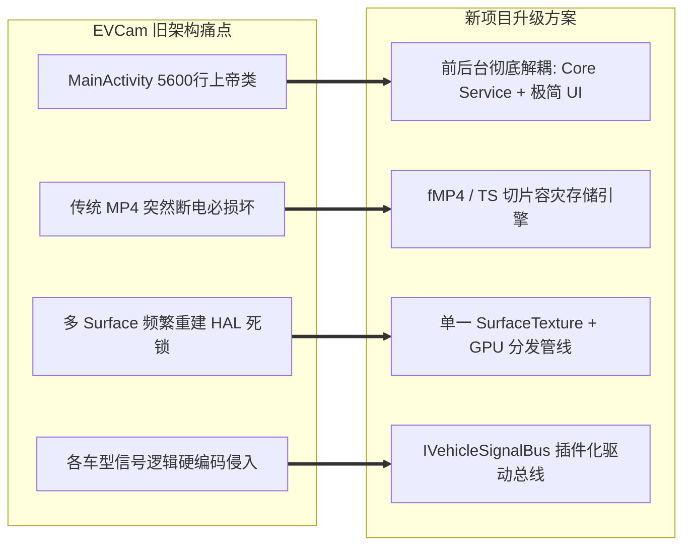

# EVCam 项目全面深度分析报告

> **编制说明**：本报告针对已停止维护的车载四向行车记录仪开源项目 [EVCam](https://github.com/your-username/EVCam)（主要面向吉利银河 E5、L6、L7、星舰7 等龙鹰一号/高通平台车机）进行全方位的架构拆解与技术复盘，旨在为新一代四向行车记录仪与智能哨兵系统的研发提供底层技术借鉴与避坑指南。

---

## 一、 项目背景与整体定位

EVCam 是一款深度定制于 Android 车载车机（主要基于 Android 9.0+ / API 28~36，FlymeAuto / 银河 OS 生态）的行车记录仪与远程监看（千里眼）应用。

### 核心特性
- **四路并发采集与录制**：支持最多 4 路摄像头（前、后、左、右）同时预览、拍照与视频分段录制。
- **车型与芯片分级适配**：支持银河 E5（硬件硬编）、银河 L6/L7（OpenGL+MediaCodec 软编）、手机端及自定义车型。
- **车身信号联动补盲**：打转向灯或开门时，自动呼出对应盲区影像（悬浮窗或副屏显示）。
- **原厂全景影像避让**：挂倒挡或开启 360 原厂全景影像时，自动隐藏第三方悬浮窗，保障行车安全。
- **车载级防杀保活**：融合高优先级 ContentProvider、透明 Activity 自启、前台服务、WorkManager、无障碍服务等多重保活机制。
- **驻车哨兵与远程监看**：支持通过钉钉 Stream SDK、Telegram、飞书 Bot 远程触发抓拍与视频录制。
- **本地便捷交互**：内置 HTTP 服务器支持手机局域网扫码高速下载视频，以及四路同屏同步回放。

---

## 二、 系统架构总览与拓扑图

```mermaid
graph TD
    subgraph 车机硬件与系统层
        CAM[Camera2 API / HAL3 设备]
        VHAL[VHAL 车辆信号总线<br/>gRPC / ECARX / Logcat]
        FS[存储系统<br/>内部高速存储 / 外置 U 盘]
    end

    subgraph 采集与编码层
        MCM[MultiCameraManager<br/>多摄像头总调度与看门狗]
        SC[SingleCamera<br/>CameraDevice 与会话状态机]
        VR[VideoRecorder<br/>MediaRecorder 硬件编码管线]
        CVR[CodecVideoRecorder<br/>MediaCodec 软编管线]
        EGL[EglSurfaceEncoder<br/>OpenGL 帧拷贝与分发]
    end

    subgraph 存储与回放层
        SH[StorageHelper<br/>U盘检测与回退]
        FTM[FileTransferManager<br/>中转写入异步队列]
        SCM[StorageCleanupManager<br/>循环覆盖与低空间保底]
        MVP[MultiVideoPlayerManager<br/>四路时间戳同步播放器]
    end

    subgraph 业务与服务层
        BSS[BlindSpotService<br/>打灯/开门补盲悬浮窗]
        CFS[CameraForegroundService<br/>前台常驻通知]
        KAM[KeepAliveManager<br/>多级防杀保活系统]
        RCD[RemoteCommandDispatcher<br/>钉钉/Telegram/飞书远程控制]
    end

    subgraph 交互与呈现 (UI)
        MA[MainActivity<br/>全景预览与控制中心]
        WEB[FileTransferServer<br/>手机扫码局域网下载]
    end

    CAM --> SC
    MCM --> SC
    SC --> VR
    SC --> EGL
    EGL --> CVR

    VR --> FTM
    CVR --> FTM
    FTM --> FS
    FS --> SCM
    FS --> MVP

    VHAL --> BSS
    BSS -.动态挂载 Surface.-> SC

    KAM --> CFS
    CFS --> MCM
    MA --> MCM
    RCD --> MCM
    FS --> WEB
```

---

## 三、 核心子系统与关键技术方案剖析

### 1. 四路 Camera2 并发采集调度 (`MultiCameraManager` & `SingleCamera`)

- **多摄像头 Session 就绪栅栏**：
  车机底层的 Camera HAL 在并发打开多个摄像头时极易出现资源竞争。`MultiCameraManager` 设计了异步就绪计数机制（`sessionConfiguredCount`、`cameraSessionReady`），四路摄像头各自独立在后台线程打开并配置，仅当所有活动摄像头均完成 Session 配置后，才统一允许触发录制，有效避免 HAL 死锁。
- **动态 Surface 多路挂载**：
  `SingleCamera` 内部集成了复杂的 Surface 分发机制。单个摄像头输出支持同时或动态挂载到：
  1. 主界面预览 (`TextureView`)
  2. 录制编码 Surface (`MediaRecorder` 或 `MediaCodec` 输入 Surface)
  3. 主屏悬浮窗 Surface (`SurfaceTexture`)
  4. 副屏 Presentation Surface
  5. MJPEG 局域网推流 Surface
- **帧流监控与自动恢复看门狗**：
  实时监测每路摄像头的出帧间隔（`STALL_TIMEOUT_MS = 2500`），一旦检测到某路摄像头断流卡死，自动启动分级自愈流程（重新创建 Session -> 重新 `openCamera`），重试上限达 90 次（约 3 分钟），有效应对车机休眠唤醒时的相机掉线问题。

---

### 2. 双视频编码管线与芯片兼容策略

为解决不同车型芯片与 HAL 限制的差异，项目研发了两套完全独立的编码管线：

| 编码管线 | 技术实现 | 适用车型 | 优势与局限 |
| :--- | :--- | :--- | :--- |
| **硬件直编 (Hardware)** | `VideoRecorder` + `MediaRecorder` | 银河 E5 | **优**：直接由硬件编解码器承接，CPU 占用极低；<br/>**劣**：要求 Camera HAL 必须支持多路并发输出，否则 Session 创建失败。 |
| **软编/GPU管线 (Software)** | `CodecVideoRecorder` + `EglSurfaceEncoder` + `MediaCodec` + `MediaMuxer` | 银河 L6 / L7 | **优**：Camera 仅输出一个 `SurfaceTexture`，在 OpenGL 中分发到预览与编码器，规避 HAL 多路输出限制，预览绝不卡死；<br/>**劣**：需要占用 GPU 与 MediaCodec 资源，对帧率自适应控制要求高。 |

- **看门狗自适应降级**：
  当优先采用 `MediaRecorder` 时，若看门狗检测到连续多次录制无数据写入（`WATCHDOG_NO_WRITE_THRESHOLD = 3`），系统会自动触发重建并**无感降级到 `CodecVideoRecorder`**。

---

### 3. 分段录制与四路时间戳纳秒级对齐

- **多路摄像头时间戳漂移痛点**：
  四路摄像头运行在独立的编码线程中，如果各自调用系统时间命名（如分段 1 分钟/3 分钟），受线程调度影响极易出现前摄为 `120000_front.mp4`、后摄为 `120001_rear.mp4`，导致回放相册无法将四路视频归为同一组。
- **解决方案 (`SegmentTimestampProvider`)**：
  在 `MultiCameraManager` 中设立统一的分段时间戳管理中心，设立 **10 秒有效期的缓存锁（`TIMESTAMP_CACHE_DURATION_MS = 10000`）**。任一路摄像头触发分段切换时生成基准时间戳，其余三路摄像头在换段时直接复用该缓存时间戳，确保四路文件名前缀完全一致。

---

### 4. 车载存储策略与“中转写入” (Relay Write)

- **外置 U 盘识别与自动回退**：
  通过 `context.getExternalFilesDirs(null)` 扫描外部介质，建立 5 秒内存缓存检测 U 盘可写状态。若 U 盘拔出或损坏，系统自动无感回退至车机内部存储（`/sdcard/DCIM/EVCam_Video/`）。
- **中转写入模式 (Relay Write)**：
  - **背景痛点**：车载 USB 接口供电波动大，部分 U 盘在高码率四路并发直写时存在周期性 I/O 停顿，极易导致 MediaCodec 丢帧甚至写入超时崩溃。
  - **解决方案**：录制时先写入内部高速闪存（NVMe/UFS），分段录制完成生成完整文件后，由后台异步工作线程（`FileTransferManager`）将文件搬移至 U 盘。
- **环形覆盖与空间兜底保护**：
  冷启动 30 秒后及每间隔 1 小时定期执行清理，超出用户设定限额（GB）后单次额外清理 20%，避免频繁擦写。内部存储低于 3GB 时触发强制低空间保护。

---

### 5. 车身信号集成与多级降级通道

项目实现了三套互为备用的车辆信号感知机制，用于监听转向灯、车速、车门及自定义按键：

1. **VHAL gRPC 管道 (`VhalSignalObserver`)**：
   通过 gRPC 通道直接连接底层车身服务，核心协议由 JNI 原生层 `libvhal_decoder.so` 进行二进制解析（适用于银河 E5、26 款星舰 7 等新架构车型）。
2. **ECARX 系统 API 反射 (`CarSignalManagerObserver`)**：
   针对吉利银河 L6/L7 等基于亿咖通旧框架的车型，利用 Java 反射直接调用 `ecarxcar_service -> ECarXCar.getCarManager("car_signal")` 获取转向灯状态。
3. **Logcat 兜底捕获 (`LogcatSignalObserver`)**：
   在权限受限的定制系统上，通过运行底层 `logcat -e` 进程正则匹配系统日志中的关键字（如 `data1 = 1/2`）作为最后一道保底方案。

- **原厂 AVM 全景避让机制**：
  悬浮窗补盲在倒车或低速打灯时，若原厂 360 全景影像弹出，第三方小窗若遮挡倒车影像将造成重大安全隐患。项目通过 `UsageStatsManager` 轮询前台 Activity，一旦检测到原厂全景启动，立即主动隐藏悬浮窗。

---

### 6. 车机环境下的多级保活体系

车机 Android 系统对第三方后台进程的查杀极为激进，EVCam 组合运用了以下保活策略：

- **极高优先级 Provider 预加载**：`KeepAliveProvider` 配置 `initOrder="2147483647"`，确保在所有组件之前被系统框架初始化。
- **透明无感开机启动**：`TransparentBootActivity` 配合开机广播，以 1x1 像素透明 Activity 拉起，绕过后台启动限制后秒退，实现用户无感后台启动。
- **前台常驻服务**：`CameraForegroundService` 持有 `foregroundServiceType="camera"` 前台通知。
- **双重保底心跳**：`KeepAliveWorker`（WorkManager 15 分钟最小周期轮询）+ `KeepAliveAccessibilityService`（无障碍服务保活）。
- **锁车息屏监视 (WakeLock)**：提供防止休眠开关，在锁车熄屏状态下维持 CPU 核心唤醒，确保持续哨兵录制。

---

### 7. 辅助生态与交互方案

- **四路同屏同步播放器 (`MultiVideoPlayerManager`)**：
  基于文件名规则将四路视频聚合为 `VideoGroup`，使用 4 个 `VideoView` / `MediaPlayer` 实例绑定同步控制器，支持单路切换、四路同屏、进度条毫秒拖拽对齐以及 0.5x~2.0x 倍速播放。
- **免拔卡扫码快传 (`FileTransferServer`)**：
  内置轻量级 HTTP Web 服务器（NanoHTTPD），车机生成 Wi-Fi 热点连接二维码。车主用手机微信扫码连入后，可在手机网页直接预览和高速下载录制视频。
- **远程千里眼架构 (`RemoteCommandDispatcher`)**：
  支持通过钉钉 Stream SDK、Telegram Bot、飞书 Bot 远程收发指令，支持拍照回传、录制短视频回传和状态心跳上报。

---

## 四、 项目技术债务与停护原因复盘

EVCam 虽然在车载兼容性上积累深厚，但其停止维护的主要原因在于后期架构陷入了难以承受的技术债务：

### 1. “上帝类”严重失控，代码难以维护
- **`MainActivity.java` 膨胀至 5,649 行（约 250KB）**，承担了 UI 布局切换、相机权限、录制触发、悬浮窗管理、远程客户端初始化等大量异构逻辑。
- **`SingleCamera.java` 达 3,345 行**，相机生命周期、Surface 管理、图像参数调优、鱼眼矫正全糅合在一起。
- **`AppConfig.java` 达 3,781 行**，上百个配置项散落，缺乏模块化配置隔离。

### 2. 重构未竟导致的“双轨制”代码割裂
在 `v1.5.8` 期间，开发者试图引入新的服务层架构（`CameraRecordingService`、`RecordingController`、`PanoramicEngine`），但重构只完成了骨架搭建，**并未在主工程中彻底替换旧代码**。主应用依然运行在旧的 `MultiCameraManager` 和 `BlindSpotService` 上，导致工程内存在大量重复且未调通的冗余类。

### 3. 突发断电下的 MP4 损坏风险
项目使用的 `MediaRecorder` 和 Android 原生 `MediaMuxer` 均采用传统的 MP4 封装方式。传统的 MP4 要求在流正常关闭时才在文件末尾写入 `moov box` 索引。**车辆突然熄火断电或电瓶切断时，当前正在录制的那一段视频会彻底损坏无法播放**，这是行车记录仪产品的致命短板。

### 4. 复杂的 Surface 状态竞争与死锁
单路相机上同时绑定了 TextureView 预览、MediaCodec 编码输入、悬浮窗、副屏 Presentation、网络流等 5 种不同去向，且分别跑在不同线程。在 Activity 生命周期切换（如前后台切换、分屏调整）时，频繁的 Surface 销毁与重建极易触发 HAL 状态死锁与黑屏。

---

## 五、 新四向行车记录仪项目的关键借鉴点与重构演进蓝图

基于 EVCam 的成败经验，新一代四向记录仪（Sophon / 极视）应采取如下重构策略：



### 1. 架构彻底解耦：Core Service 与 UI Client 分离
- 业务内核完全常驻在独立后台服务中，包含完整的采集、编码、存储与车身监听。
- UI 仅作为纯粹的呈现端（通过 Binder IPC 或 Local Broadcast 与 Service 通信），UI 退出或崩溃绝不影响录制。

### 2. 引入容灾型视频封装容器 (fMP4 / TS)
- 放弃一次性写入 `moov` 的标准 MP4，**全面改用 Fragmented MP4 (fMP4) 或 TS 流式切片**。
- 视频数据每秒或每个 GOP 作为一个独立 Fragment 即时刷盘。车辆即使在发生剧烈碰撞突然断电，也能完整保全断电前最后一秒的视频证据。

### 3. 统一管线化视频采集 (Single Input -> GPU Compositor)
- 彻底摒弃一个 CameraDevice 挂载 5 个 Surface 的混乱模式。
- 每个物理摄像头仅输出到唯一的 OES `SurfaceTexture`；所有预览、录制编码、补盲小窗、推流等需求全部通过统一的 **OpenGL ES / EGL 离屏渲染管线** 进行帧拷贝与尺寸变换，将 HAL 交互降到最低。

### 4. 车身信号驱动抽象化 (`IVehicleSignalBus`)
- 定义统一的 `IVehicleSignalBus` 接口，将 VHAL gRPC、亿咖通反射、Logcat 解析封装为独立的驱动适配器，对上层业务提供标准化的响应式数据流（Flow / LiveData），新增车型只需增加一个驱动适配器，不侵入核心业务。

### 5. 环形缓冲与安全存储引擎
- 保留并升级“中转写入”思想，设计标准的双层存储引擎：内存环形队列（Ring Buffer） -> 本地高速 Cache 分段 -> 异步搬运至外置 U 盘，彻底隔绝外置存储卡 I/O 阻塞对录制帧率的影响。
