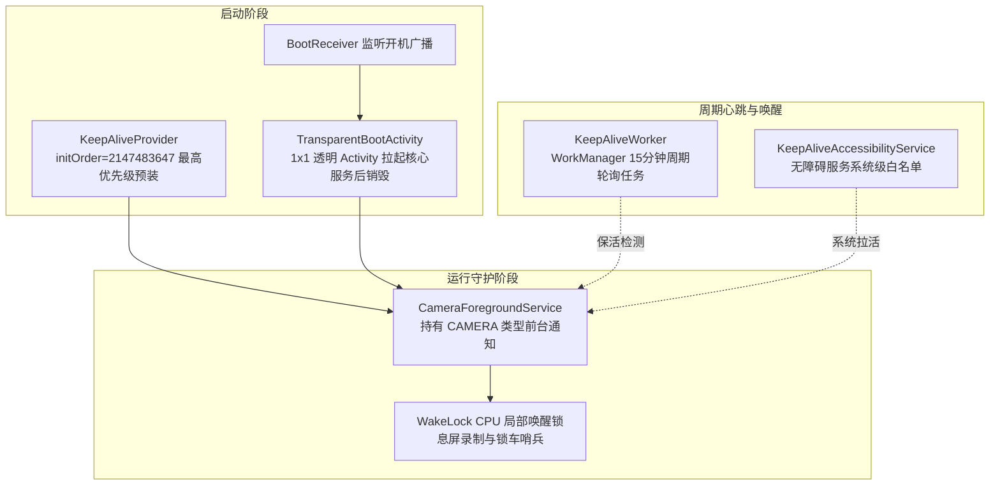

# EVCam 底层核心技术深度解析与避坑白皮书

> **文档性质**：代码级深度逆向与架构剖析文档  
> **研究对象**：EVCam (Android 9.0~14+ / API 28~36 车载四向记录仪系统)  
> **适用目标**：为新一代车载视觉系统（Sophon / 智子）提供底层核心算法、HAL 通信、GPU 管线、车身协议与硬件避坑的工程级参考。

---

## 一、 源码全景图谱与模块清单

EVCam 代码总量约 3.5 万行 Java + C++ (JNI)，主要模块分布如下：

| 包路径 / 核心类 | 代码行数 (LOC) | 核心职责 | 复杂度与技术债评级 |
| :--- | :--- | :--- | :--- |
| `com.kooo.evcam.MainActivity` | 5,649 行 | 顶层 UI 交互、相机权限、视图切换、远程控制初始化、悬浮窗协调 | 🔴 极高（严重违背单一职责） |
| `camera.SingleCamera` | 3,345 行 | 单摄 Camera2 设备状态机、多 Surface 动态挂载、帧率监控、自愈重连 | 🔴 极高（状态机与线程交错） |
| `camera.MultiCameraManager` | 2,358 行 | 四摄并发管理、Session 就绪栅栏、分段时间戳同步、看门狗降级 | 🟡 中高（同步逻辑复杂） |
| `camera.CodecVideoRecorder` | 1,842 行 | OpenGL+MediaCodec 软编管线、自适应 Drain、分段换段重建 | 🟡 中高（包含多次重构痕迹） |
| `camera.VideoRecorder` | 1,270 行 | MediaRecorder 硬编管线、Session 暂停配合、文件健康度检查 | 🟡 中等 |
| `camera.EglSurfaceEncoder` | 906 行 | EGL14 上下文生命周期、OES 外部纹理采样 Shader、时间水印 Alpha 混合、PTS 注入 | 🟢 优良（纯粹且复用性高） |
| `camera.FisheyeCorrector` | 609 行 | Brown-Conrady 径向畸变矫正 Shader、多 Surface 共享渲染管线 | 🟢 优良（算法清晰） |
| `VhalSignalObserver` / `VhalNative` | 620 行 | gRPC Server-Streaming 车身信号管道、JNI 二进制协议解码桥接 | 🟢 优良（低延迟高可靠） |
| `CarSignalManagerObserver` | 364 行 | 吉利/亿咖通 `ecarxcar_service` Java 反射适配器 | 🟡 中等（依赖底层闭源接口） |
| `LogcatSignalObserver` | 207 行 | `logcat -e` 底层子进程正则过滤兜底 | 🟢 优良（极端条件下的有效保底） |
| `StorageHelper` / `StorageCleanupManager` | 1,100 行 | 外置 U 盘检测缓存、中转写入 (Relay Write)、双阈值低空间防爆护盘 | 🟢 优良（车载闪存友好） |
| `BlindSpotService` | 2,403 行 | 转向灯/开门补盲悬浮窗、副屏 Presentation、原厂 AVM 全景避让轮询 | 🟡 中高（WindowManager 参数繁琐） |
| `playback.MultiVideoPlayerManager` | 680 行 | 四路 `MediaPlayer` 纳秒时间戳同屏同步渲染、倍速协同控制 | 🟢 优良（音视频对齐逻辑完整） |
| `transfer.FileTransferServer` | 1,289 行 | 基于 NanoHTTPD 的轻量级车载局域网 Web 服务器与扫码断点续传 | 🟢 优良（车载极佳实用功能） |

---

## 二、 多路 Camera2 并发采集体系深度剖析

### 1. 车载 HAL3 并发访问痛点与解决方案
车载芯片（如龙鹰一号 SE1000、高通 8155）虽然有多个 MIPI-CSI 接口，但底层 Camera Provider / HAL3 的并发资源极其敏感。

```
[CameraDevice 0..3] 
       │
  (后台并发异步 openCamera)
       ▼
[SingleCamera.onOpened] ────► sessionConfiguredCount++
       │
  (创建 CaptureSession)
       ▼
[SingleCamera.onConfigured] ─► cameraSessionReady[cameraKey] = true
       │
  (进入就绪栅栏)
       ▼
[MultiCameraManager.sessionLock] ──► sessionConfiguredCount == expectedSessionCount?
                                            │
                                            ├── 是: 触发 pendingRecordingStart.run()
                                            └── 否: 等待或 5000ms 超时强制启动
```

- **异步就绪栅栏 (Session Configuration Barrier)**：
  每个摄像头打开耗时在 200~800ms 不等。`MultiCameraManager` 在 `initCameras()` 中维护 `sessionConfiguredCount` 和 `cameraSessionReady` 哈希表，使用 `synchronized(sessionLock)` 保证只有所有预设摄像头全部进入 `onConfigured` 状态后，才允许向录制器下发启动指令。
- **超时保底机制**：
  设立 5000ms 的 `sessionTimeoutRunnable`。若某个副摄因硬件接触不良超时未响应，栅栏超时触发，剔除失败摄像头，降级保证其余正常摄像头继续启动录制（通过 `RecordingStatusCallback.onPartialRecordingStart` 上报）。

### 2. SurfaceTexture 的 BufferQueue 假死陷阱与修复
在 `CodecVideoRecorder` 和 `SingleCamera` 中存在一个致命的 Android 底层机制陷阱：
- **陷阱机制**：Camera2 的输出 Surface 绑定到底层的 `SurfaceTexture`。`SurfaceTexture` 内部由 3~4 个缓冲区的 `BufferQueue` 驱动。
- **致命问题**：当用户在界面上“停止录制”但保持预览，或者相机尚未启动录制时，如果代码中**忽略了 `onFrameAvailable` 回调、未调用 `updateTexImage()` 消费图像帧**，`BufferQueue` 会在 3 帧之内被彻底填满；此后底层 HAL 无法推入新帧，导致**整路 Camera 彻底假死，再也不产生任何帧可用回调**！
- **EVCam 核心修复实现 (`CodecVideoRecorder.java#L394-L403`)**：
  ```java
  inputSurfaceTexture.setOnFrameAvailableListener(surfaceTexture -> {
      if (!isRecording.get() || !encoderHealthy) {
          // 关键修复：即使非录制状态，也必须通过 consumeFrame() 消费纹理！
          if (eglEncoder != null && eglEncoder.isInitialized()) {
              eglEncoder.consumeFrame(); // 执行 makeCurrent() + updateTexImage()
          }
          return;
      }
      // 正常编码路径...
  });
  ```

### 3. 断流卡死检测与分级自愈状态机
`SingleCamera` 内部运行着 1000ms 轮询的 `healthCheckRunnable`：
- **判定阈值**：`System.currentTimeMillis() - lastFrameTimestampMs > STALL_TIMEOUT_MS (2500ms)`。
- **分级恢复策略**：
  - **Level 1 (会话重建)**：不销毁 `CameraDevice`，调用 `captureSession.stopRepeating()`，随后清空 Surface 缓存并重新调用 `createCaptureSession`。
  - **Level 2 (硬件重连)**：彻底关闭并释放 `CameraDevice`，清除 HandlerThread，重新以递增延迟（2秒、4秒、8秒）调用 `cameraManager.openCamera()`，最多重试 90 次（覆盖车辆休眠至唤醒的完整窗口）。

---

## 三、 双视频编码管线硬核拆解

### 1. 管线 A：硬件直编 (`VideoRecorder` + `MediaRecorder`)
- **优点**：直接使用系统驱动级编码服务，录制四路 1080P/720P 时 CPU 占用不足 5%。
- **致命短板**：
  1. `MediaRecorder.getSurface()` 生成的 Surface 在分段切换时**必须彻底重新创建**；
  2. 导致每隔 1 分钟/3 分钟分段，Camera2 必须重启 CaptureSession，**造成 500ms~1000ms 录制盲区**。
  3. 部分车型 HAL（如银河 L6/L7）不支持 MediaRecorder 的 Surface 与 TextureView 并发输出，一旦开启直接黑屏。

### 2. 管线 B：软编/GPU 管线 (`EglSurfaceEncoder` + `MediaCodec`)
针对无法使用 `MediaRecorder` 的平台，EVCam 采用纯 GPU 离屏管线实现：

```
[Camera2] 
    │ (唯一输出)
    ▼
[SurfaceTexture (OES Texture)] 
    │
    ▼ (onFrameAvailable)
[EglSurfaceEncoder (OpenGL ES 2.0)]
    ├── 1. makeCurrent() 绑定当前编码线程 EGLContext
    ├── 2. updateTexImage() 获取帧并提取变换矩阵 texMatrix
    ├── 3. 片段着色器混合 (OES 原图 + 时间戳水印 Bitmap 纹理)
    ├── 4. eglPresentationTimeANDROID(presentationTimeNs) 纳秒级 PTS 注入
    └── 5. eglSwapBuffers() 送入编码器输入 Surface
            │
            ▼
   [MediaCodec.createInputSurface()]
            │ (硬件/软件编码 H.264/HEVC)
            ▼
   [drainEncoderWithResult()] (提取 ByteBuffer)
            │
            ▼
   [MediaMuxer] ──► 写入本地 MP4 文件
```

#### EGL 与着色器核心实现细节：
- **OES 纹理采样与 Alpha 水印混合 Shader (`EglSurfaceEncoder.java`)**：
  ```glsl
  #extension GL_OES_EGL_image_external : require
  precision mediump float;
  varying vec2 vTextureCoord;
  uniform samplerExternalOES sTexture;
  uniform sampler2D sWatermarkTexture;
  uniform vec4 uWatermarkRect; // [x, y, w, h] 归一化坐标

  void main() {
      vec4 videoColor = texture2D(sTexture, vTextureCoord);
      if (vTextureCoord.x >= uWatermarkRect.x && vTextureCoord.x <= uWatermarkRect.x + uWatermarkRect.z &&
          vTextureCoord.y >= uWatermarkRect.y && vTextureCoord.y <= uWatermarkRect.y + uWatermarkRect.w) {
          vec2 watermarkCoord = vec2(
              (vTextureCoord.x - uWatermarkRect.x) / uWatermarkRect.z,
              (vTextureCoord.y - uWatermarkRect.y) / uWatermarkRect.w
          );
          vec4 watermarkColor = texture2D(sWatermarkTexture, watermarkCoord);
          gl_FragColor = mix(videoColor, watermarkColor, watermarkColor.a);
      } else {
          gl_FragColor = videoColor;
      }
  }
  ```
- **相对纳秒时间戳计算**：
  直接传 `System.nanoTime()` 会因车辆熄火睡眠出现跳变，导致 GraphicBufferSource 拒收帧。
  ```java
  if (firstFrameTimestampNs < 0) {
      firstFrameTimestampNs = absoluteTimestampNs;
  }
  long relativeTimestampNs = absoluteTimestampNs - firstFrameTimestampNs;
  EGLExt.eglPresentationTimeANDROID(eglDisplay, eglSurface, relativeTimestampNs);
  ```

### 3. 鱼眼畸变矫正算法 (`FisheyeCorrector`)
车身侧视和后视通常是 150°~180° 超广角鱼眼镜头，用于打灯补盲时畸变严重影响距离判断。`FisheyeCorrector` 采用 **Brown-Conrady 径向畸变矫正模型** 在 GPU 端实时逆运算：

$$\begin{aligned}
\vec{coord} &= \frac{\vec{rotated} - \vec{uCenter}}{uZoom} \\
r &= \|\vec{coord}\| \\
distortion &= 1.0 + k_1 \cdot r^2 + k_2 \cdot r^4 \\
\vec{corrected} &= \vec{coord} \cdot distortion + \vec{uCenter}
\end{aligned}$$

- **GLSL 实现要点**：在屏幕空间反算无畸变纹理坐标，超出 $[0, 1]$ 归一化视锥的部分直接填充黑色 (`vec4(0.0, 0.0, 0.0, 1.0)`)，并通过 $uZoom$ 缩放系数将有效视野扩展裁除黑边。

---

## 四、 分段录制、丢帧根因与时间戳同步

### 1. 分段切换时“500ms 盲区丢帧”的根本原因拆解
在行车记录仪中，分段切换（如 1 分钟一段）必须平滑无缝。EVCam 在分段切换时均存在不同程度的帧丢失：
- **`VideoRecorder` 管线的掉帧原因**：
  `MediaRecorder` 无法动态更改底层输出文件句柄。换段时必须调用 `stop()`，导致关联的 CameraCaptureSession 必须重配置，**物理盲区约 500ms~1000ms**。
- **`CodecVideoRecorder` 管线的掉帧原因**：
  Android 系统原生 `MediaMuxer` 同样不支持换文件。EVCam 在 `stopRecordingForSegmentSwitch()` 中的做法是：
  1. 调用 `encoder.signalEndOfInputStream()` 并排空帧；
  2. 停止并释放 `MediaMuxer`；
  3. **彻底 `stop()` 和 `release()` 整个 `MediaCodec` 实例！**
  4. 重新 `MediaCodec.createByCodecType()`，重新配置并启动编码器；
  5. 重新调用 `eglEncoder.updateOutputSurface(newSurface)` 绑定 EGL。
  - **开销代价**：在车机高通 8155 / 龙鹰一号上，MediaCodec 销毁与重新初始化耗时在 **150ms~350ms**，期间相机采集到的帧全部被丢弃！

> 🌟 **新项目 (Sophon) 终极解法**：
> 1. **编码器永不重启**：`MediaCodec` 从录制开始到结束**全程常驻编码**，永不停止。
> 2. **关键帧无感切片**：采用自定义 MP4 Muxer 或在 H.264/H.265 的 **IDR 关键帧（Keyframe）** 边界直接分流字节流至新文件，实现 **0 毫秒、0 丢帧** 的真正无缝切段！

### 2. 四路时间戳漂移的工程级解决 (`SegmentTimestampProvider`)
- **多线程不同步问题**：四路录制线程完全独立。当第 60 秒到期触发切片时，若各自调用 `new SimpleDateFormat().format(new Date())`，由于 CPU 时间片切片顺序不同，前摄生成 `120000_front.mp4`，右摄却生成 `120001_right.mp4`，造成相册无法按时间戳聚类。
- **EVCam 的 10 秒窗口缓存锁**：
  ```java
  public String getSegmentTimestamp() {
      synchronized (timestampLock) {
          long now = System.currentTimeMillis();
          if (cachedSegmentTimestamp != null && (now - timestampGeneratedTime) < 10000) {
              return cachedSegmentTimestamp; // 10秒内四路摄像头共用同一个时间戳
          }
          cachedSegmentTimestamp = new SimpleDateFormat("yyyyMMdd_HHmmss", Locale.getDefault()).format(new Date());
          timestampGeneratedTime = now;
          return cachedSegmentTimestamp;
      }
  }
  ```

---

## 五、 存储子系统与车载 I/O 优化

### 1. 中转写入机制 (Relay Write / `FileTransferManager`)
- **问题场景**：车载 USB 接口在行车颠簸、大功率空调启动时，供电电压存在瞬时跌落；部分廉价 FAT32/exFAT U 盘在持续四路高码率直写时会触发 Flash 内部 GC，导致 I/O 卡顿长达数秒，引发 MediaCodec 缓冲区溢出。
- **处理管线**：
  ```
  [四路录制器] ──(实时写入)──► /sdcard/Android/data/.../Cache/ (内部高速 UFS/NVMe)
                                         │
                                   (录制分段完成)
                                         ▼
                             [FileTransferManager 任务队列]
                                         │
                             (后台守护线程低优先级 I/O 搬移)
                                         ▼
                            /storage/xxxx-xxxx/DCIM/EVCam_Video/ (外置 U 盘)
  ```

### 2. 双重存储安全守护 (`StorageCleanupManager`)
- **冷启动与周期检查**：开机 30 秒后首次执行，随后每 60 分钟定时巡检。
- **20% 额外释放滞后量 (Hysteresis Buffer)**：达到限制容量（如用户设置 64GB 满）时，并非只删除刚好超出的文件，而是**多删除 20%**，避免文件刚满后每个分段都在高频触发文件系统 unlink 操作造成存储闪存磨损与系统卡顿。
- **3GB 低空间强行保底**：当内置存储可用空间低于 3GB 时，强制触发覆盖清理，确保车机系统不会因磁盘空间耗尽发生 UI 奔溃或重启。

---

## 六、 车身信号总线与底层通信机制

### 1. VHAL gRPC 管道通信深度拆解
针对银河 E5、26 款星舰 7 等新一代吉利电子电气架构（GEA 架构），EVCam 逆向打通了车内系统的 gRPC 服务：
- **信道建立**：
  通过 `OkHttpChannelBuilder.forAddress(host, port).usePlaintext()` 创建通道。在元数据请求头中注入：
  - `session_id`: 随机生成的 UUID
  - `client_id`: `"evcam_signal"`
- **底层 JNI 解码 (`libvhal_decoder.so`)**：
  Java 层通过 `MethodDescriptor.MethodType.SERVER_STREAMING` 建立无边界数据流。当底层车身 CAN 网关产生属性变化时，通过 `VhalNative.decode(byte[] rawData)` 解码为三元组事件数组：
  ```
  [事件总数 N, 
   事件类型1, 参数P1, 参数P2, 
   事件类型2, 参数P1, 参数P2, ...]
  ```
- **核心车身事件表**：
  | 事件枚举 (`type`) | 参数 1 (`p1`) | 参数 2 (`p2`) | 业务触发逻辑 |
  | :--- | :--- | :--- | :--- |
  | `EVT_TURN_SIGNAL (1)` | `DIR_LEFT(1)` / `DIR_RIGHT(2)` / `DIR_NONE(0)` | - | 弹出/关闭对应侧盲区悬浮窗或副屏投屏 |
  | `EVT_DOOR_OPEN (2)` | `DOOR_FR(2)` / `DOOR_RL(3)` / `DOOR_RR(4)` | - | 开门防碰撞预警，点亮对应侧后视摄像头 |
  | `EVT_DOOR_CLOSE (3)` | 同上 | - | 延迟 1200ms 防抖后关闭影像 |
  | `EVT_SPEED (4)` | 车速浮点数 (`Float.intBitsToFloat`) | - | 高速/低速阈值过滤（低速打灯才补盲） |
  | `EVT_CUSTOM_KEY (5)` | 方向盘自定义按键状态 (0/1) | - | 唤醒主界面或触发紧急录制与拍照 |

### 2. ECARX 反射通信管道 (`CarSignalManagerObserver`)
在银河 L6/L7（基于吉利银河 OS / 亿咖通平台）上，gRPC 端口被禁用，项目通过 Java 反射介入私有 framework：
- **反射调用链**：
  ```
  Class.forName("com.ecarx.xui.adaptapi.car.Car")
      --> method "create"
      --> getCarManager("car_signal")
      --> Method "getIndcrSts()" (获取转向指示灯状态)
  ```
- **轮询防抖**：采用 200ms 的 Handler 轮询机制，维护 `lastTurnSignalState` 过滤重复无效回调。

### 3. AVM 原厂全景主动避让策略 (`BlindSpotService`)
- **安全红线**：国家工信部法规对倒车影像有极高的安全要求。第三方补盲悬浮窗在车主倒车（R 挡）或主动开启 360 原厂全景时，必须**无条件隐藏避让**。
- **前台感知实现**：
  通过系统 `UsageStatsManager` 轮询前台活跃的 Activity，一旦比对命中配置的 AVM 全景 Activity 类名（或自身进入前台），立即触发 `hideDedicatedBlindSpotWindow()`；在退出 AVM 后经连续 2 次（2 秒）防抖确认后，才恢复悬浮窗显示。

---

## 七、 车机环境下的多级防杀保活架构

车机定制 Android 系统针对第三方应用拥有极为残酷的杀后台策略（如无操作 5 分钟杀、锁车休眠立杀、高内存杀）。EVCam 采用组合防御：



1. **`KeepAliveProvider` (优先级抢占)**：利用 Android 框架在所有 Application、Activity 启动之前优先拉起 ContentProvider 的特性，设置 `android:initOrder="2147483647"`，最早获得进程控制权。
2. **`TransparentBootActivity` (绕过后台启动限制)**：Android 10+ 严格限制从 Service/Receiver 后台启动 Activity。项目配置一个透明不可见的 1 像素 Activity，随开机广播启动，拉起前台服务后立刻 `finish()`，对车机屏幕完全不产生闪烁感知。
3. **`KeepAliveAccessibilityService`**：在 Android 系统中，开启无障碍服务的应用会被系统划入低风险保护白名单，显著降低被 OOM Killer 杀死的权重。

---

## 八、 EVCam 核心缺陷与架构陷阱复盘

新项目开发必须坚决规避以下 4 大架构陷阱：

| 陷阱与缺陷 | EVCam 旧代码的表现 | 引发的严重后果 | 新项目 (Sophon) 改造方案 |
| :--- | :--- | :--- | :--- |
| **1. 巨石上帝类** | `MainActivity` 5649 行、`SingleCamera` 3345 行，逻辑全部挤在一个类中 | 任何改动都会引入连锁 Bug，排查死锁几乎不可能 | **严格 Clean Architecture**：核心引擎完全下沉独立服务，UI 仅作为观察者客户端 |
| **2. 断电 MP4 损坏** | 原生 `MediaMuxer` 必须正常 `stop()` 才能在尾部写入 `moov box` | 车辆突然断电熄火、拔电瓶时，**当前分段视频必彻底损坏**，无法作为事故证据 | **全面采用 fMP4 / TS 容器**：以 GOP / 秒为单位实时刷盘，断电保全最后一秒记录 |
| **3. 换段销毁重建** | 每 1 分钟分段必须释放并重建 `MediaCodec` 或 `CaptureSession` | 每次换段产生 **150ms~1000ms 盲区丢帧**，两段视频无法平滑拼合 | **单管线持续编码**：MediaCodec 终身不重启，仅在 IDR 关键帧切换输出 Muxer |
| **4. Surface 状态竞争** | 单相机挂载 5 个 Surface，跨 3 个线程频繁动态增减与重建 Session | 极易触发 Camera HAL 状态死锁，前后台切换时黑屏死机 | **单一 OES 输出 + GPU 离屏分发**：Camera 只输出唯一 SurfaceTexture，一切呈现由 EGL 绘制 |

---

## 九、 新项目 (Sophon) 核心架构升级执行蓝图

### 1. 总体分层拓扑架构

```
┌─────────────────────────────────────────────────────────────┐
│                 Presentation Layer (UI 客户端)              │
│   Compose / 响应式 UI ──► 四路实时监看 / 画中画回放 / 车型配置微调 │
└──────────────────────────────┬──────────────────────────────┘
                               │ IPC / Binder / StateFlow
┌──────────────────────────────▼──────────────────────────────┐
│             Sophon Core Service (核心后台守护服务)           │
│                                                             │
│   ┌─────────────────────────────────────────────────────┐   │
│   │  Vehicle Signal Bus (IVehicleSignalBus)             │   │
│   │  ├── GrpcVhalAdapter (新架构车型 gRPC 驱动)          │   │
│   │  ├── EcarxAdapter (亿咖通反射驱动)                  │   │
│   │  └── LogcatAdapter (系统日志兜底驱动)               │   │
│   └──────────────────────────┬──────────────────────────┘   │
│                              ▼                              │
│   ┌─────────────────────────────────────────────────────┐   │
│   │  Vision Pipeline (统一视觉流水线)                    │   │
│   │  ├── Camera2 Master Scheduler (多摄状态就绪栅栏)     │   │
│   │  ├── GPU Offscreen Compositor (EGL/OES 帧分发引擎)  │   │
│   │  │   ├── Fisheye Lens Shader (鱼眼畸变矫正)          │   │
│   │  │   └── Watermark Shader (OSD 硬件时间角标)        │   │
│   │  ├── Continuous MediaCodec Engine (不间断编码引擎)  │   │
│   │  └── Fault-Tolerant Muxer (fMP4/TS 容灾封装器)      │   │
│   └──────────────────────────┬──────────────────────────┘   │
│                              ▼                              │
│   ┌─────────────────────────────────────────────────────┐   │
│   │  Two-Tier Storage Engine (双层存储引擎)             │   │
│   │  ├── Ring Buffer (内存环形帧缓冲队列)              │   │
│   │  ├── Cache Vault (内部高速闪存分段落盘)             │   │
│   │  └── Async USB Relayer (异步外置 U 盘搬运工)         │   │
│   └─────────────────────────────────────────────────────┘   │
└─────────────────────────────────────────────────────────────┘
```

### 2. 关键核心模块的接口设计规范

#### ① 车身信号总线标准接口 (`IVehicleSignalBus.kt`)
```kotlin
interface IVehicleSignalBus {
    /** 响应式订阅车身转向灯事件 (LEFT / RIGHT / OFF) */
    val turnSignalFlow: StateFlow<TurnSignalState>
    
    /** 响应式订阅车门开启状态 (FR / FL / RR / RL) */
    val doorStateFlow: StateFlow<DoorState>
    
    /** 响应式订阅车速 (m/s) */
    val speedFlow: StateFlow<Float>
    
    /** 响应式订阅原厂 360 AVM 激活状态 (用于主动避让) */
    val avmActiveFlow: StateFlow<Boolean>

    fun start()
    fun stop()
}
```

#### ② 容灾型录制引擎接口 (`IRecordingPipeline.kt`)
```kotlin
interface IRecordingPipeline {
    /** 初始化并绑定物理摄像头，输入唯一的 SurfaceTexture */
    fun bindCameraInput(cameraId: String, surfaceTexture: SurfaceTexture)
    
    /** 启动持续不间断录制 */
    fun startContinuousRecording(config: RecordingConfig)
    
    /** 无感切割生成新分段（必须在 IDR 关键帧处无缝切换，保证 0 毫秒丢帧） */
    fun rotateSegment(timestamp: Long): SegmentResult
    
    /** 停止录制并安全刷盘 */
    fun stopRecording()
}
```

---

## 十、 结语

EVCam 是一个在车载定制生态中趟过无数深坑的先驱型工程，其在 **多摄 Session 异步栅栏、gRPC 车身信号嗅探、OES GPU 离屏水印渲染、U 盘中转异步存储** 等方面的处理逻辑极为精妙，具有极高的重用价值。

新项目 **Sophon (智子)** 将全面汲取这些实战核心资产，同时通过现代化的架构解耦、永不断流的 MediaCodec 编码、以及 fMP4 容灾封装，彻底终结前代项目的代码腐蚀与硬件丢帧问题，打造真正车载级的四向记录与全维感知旗舰！
